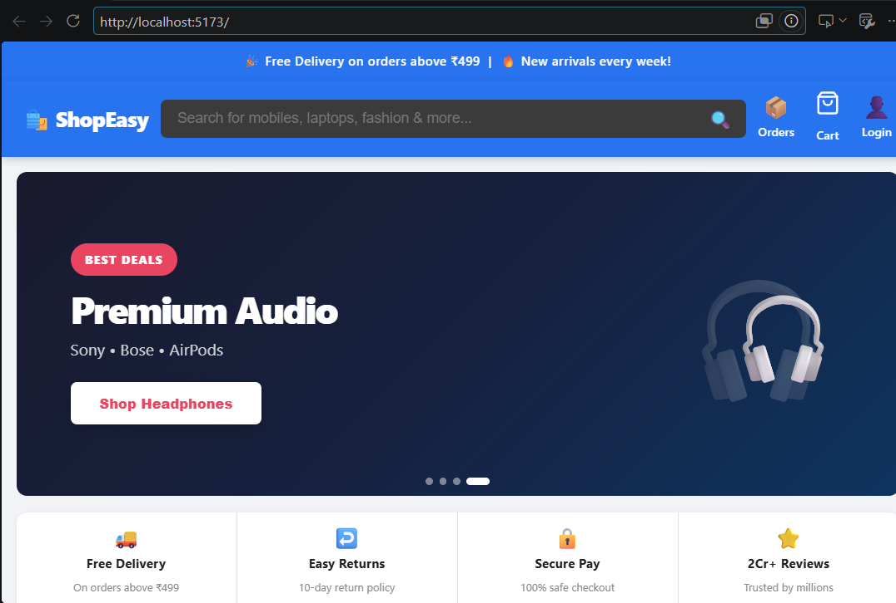
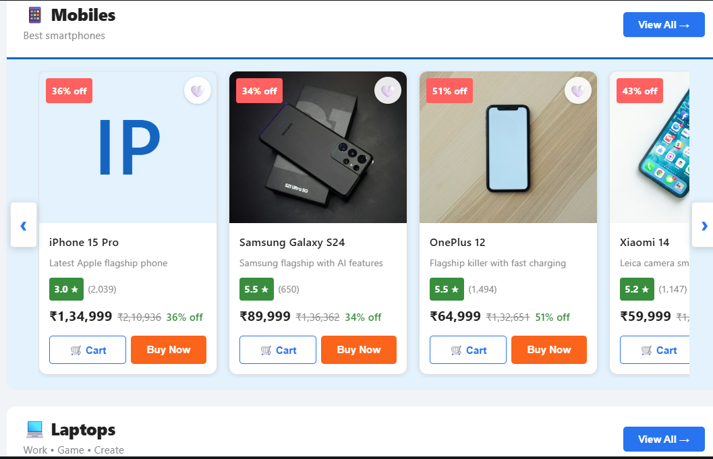

# 🛍️ ShopEasy – Multi-Vendor E-Commerce Platform

A full-stack multi-vendor e-commerce web application built with **React.js** (frontend) and **Spring Boot** (backend REST API) with a **MySQL** database. Buyers can browse and purchase products, and vendors can manage their own product listings.

## ✨ Features

### Buyer
- User registration and login with **JWT authentication**
- Homepage with hero carousel and product sections
- Product cards with discount badge, star rating, wishlist and add-to-cart
- Cart and wishlist management
- Three-step checkout: Address → Payment → Order Review

### Vendor
- Vendor dashboard for product management
- Add, edit and delete products

### General
- Role-based access control (Buyer / Vendor)
- REST APIs tested with Postman
- Auto-seeded sample data (62 products) using a DataSeeder

## 🧰 Tech Stack

| Layer | Technologies |
|-------|--------------|
| Frontend | React.js, Vite, Redux, CSS |
| Backend | Java, Spring Boot, Spring MVC, Spring Security |
| Database | MySQL |
| Security | JWT (JSON Web Token) |
| Tools | Postman, Git, GitHub, VS Code |

## 🏗️ Architecture

Three-tier architecture:
1. **Presentation layer** – React.js UI
2. **Business logic layer** – Spring Boot REST API
3. **Data layer** – MySQL database

## 📁 Project Structure

```
Shope-Easy-react--project/
├── backend/     # Spring Boot REST API
├── frontend/    # React.js application
└── README.md
```

## 📸 Screenshots

### Homepage


### Product Page


## 🚀 How to Run

### Prerequisites
- Java 17 or higher ⚠️ (use the version your project uses)
- Maven
- Node.js and npm
- MySQL

### Backend
1. Go to the backend folder:
```bash
   cd backend
```
2. Create a MySQL database:
```sql
   CREATE DATABASE shopeasy;
```
3. Open `src/main/resources/application.properties` and update your MySQL username and password.
4. Run the application:
```bash
   mvn spring-boot:run
```
   The backend starts at `http://localhost:8080` ⚠️ (check your port)

### Frontend
1. Go to the frontend folder:
```bash
   cd frontend
```
2. Install dependencies:
```bash
   npm install
```
3. Start the app:
```bash
   npm run dev
```
   The frontend opens at `http://localhost:5173` ⚠️ (Vite default; use `npm start` if your project uses it)

## 🔗 API Overview

| Method | Endpoint | Description |
|--------|----------|-------------|
| POST | `/api/auth/register` | Register a new user |
| POST | `/api/auth/login` | Login and receive JWT token |
| GET | `/api/products` | Get all products |
| POST | `/api/products` | Add a product (Vendor) |

⚠️ Replace these with your actual endpoints from your controllers.

## 📅 Project Timeline

Developed over 12 weeks: Planning → Backend → Frontend → Integration & Testing → Documentation.

## 👨‍💻 Author

**Sumant Tiwary** – [LinkedIn](https://www.linkedin.com/in/sumanttiwary)
